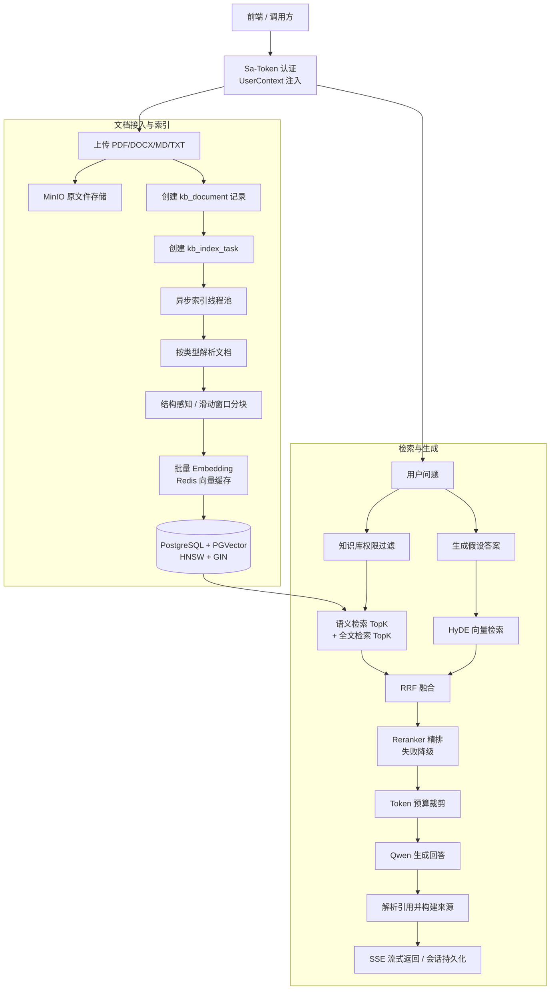

# RAG-KB：企业内部知识库问答系统（面试复习版）

> 一套基于 **Spring Boot 3.5、Spring AI、PostgreSQL + PGVector、Redis、MinIO** 的企业级 RAG 知识库后端。它解决的不是“调用一次大模型”的问题，而是将企业文档接入、权限隔离、检索增强、可追溯生成、流式交互与离线评估串成可运营的完整链路。

本文以当前仓库代码为准，适合面试前快速复习和按模块深挖。性能或效果数字请以实际压测、评测报告为准，本文不虚构线上指标。

## 1. 30 秒项目介绍

我实现了一个企业内部 RAG 知识库系统。用户可以上传 PDF、DOCX、Markdown、TXT 等文档，系统异步完成解析、智能分块和向量化，并将原文件存到 MinIO、向量与全文索引存到 PostgreSQL/PGVector。问答时，系统先按用户、部门或公开库权限过滤知识库，再通过“向量检索 + 全文检索 + RRF 融合 + HyDE 增强 + Reranker 精排”召回高相关内容；在 Token 预算内构建上下文，调用大模型生成带来源引用的答案，并支持 SSE 流式返回、会话持久化、用户反馈与 Hit Rate/MRR/忠实度评估。

**要解决的核心问题：**

1. 企业知识分散在多种文档中，单纯关键词搜索无法理解语义。
2. 纯向量检索对接口名、制度条款、错误码等精确术语召回不稳定。
3. LLM 可能编造内容，需要约束生成、展示来源并能离线评估。
4. 文档重新索引耗时且依赖外部模型，不能影响在线查询。
5. 企业文档有部门和用户级隔离，权限必须在检索前生效。

---

## 2. 技术栈与职责划分

| 层级 | 选型 | 在项目中的作用 |
| --- | --- | --- |
| 应用框架 | Java 21、Spring Boot 3.5 | REST API、依赖注入、异步任务、监控端点 |
| AI 接入 | Spring AI、DashScope OpenAI 兼容接口 | 对接 Qwen 聊天模型与 `text-embedding-v3` 向量模型 |
| 向量/关系存储 | PostgreSQL、PGVector、MyBatis-Plus | 存储知识库、文档、分块、向量、会话、评估数据 |
| 检索索引 | HNSW 向量索引、GIN 全文索引 | 分别承担语义检索与关键词检索 |
| 缓存 | Redis | Embedding 缓存；预留问答结果缓存服务 |
| 文件存储 | MinIO | 存放上传的原始文档 |
| 安全 | Sa-Token + ThreadLocal `UserContext` | 登录态、用户/部门/角色上下文与权限校验 |
| 异步与流式 | `ThreadPoolTaskExecutor`、SSE | 文档索引后台执行、回答 Token 流式输出 |
| 可观测性 | Actuator、Prometheus、Trace Filter | 健康检查、指标暴露、请求 traceId 日志关联 |
| 文档解析 | PDFBox、Apache POI、Flexmark | PDF、DOCX、Markdown、TXT 的统一解析 |

---

## 3. 总体架构



### 面试时的架构讲法

系统拆成两条主链路：**离线索引链路**负责把非结构化文档变成可检索的知识单元，**在线问答链路**负责在权限边界内召回、筛选、生成并回传答案。这样做的好处是，耗时且不稳定的文档解析、Embedding 等工作不会占用在线请求线程；在线链路只读取已完成索引的数据，能更好地控制时延和稳定性。

---

## 4. 核心链路一：文档接入与异步索引

### 4.1 从上传到可检索的流程

1. `KnowledgeBaseController` 接收文件上传，先通过 `PermissionService.requireWrite` 校验写权限。
2. `KnowledgeBaseService.uploadDocument` 校验文件后缀，仅允许 PDF、DOCX、MD、TXT。
3. 原文件上传到 MinIO，数据库写入 `kb_document` 元数据，状态初始为 `PENDING`。
4. 创建 `kb_index_task`，使用 `indexTaskExecutor` 将索引任务异步执行。
5. `DocumentLoaderService` 根据扩展名路由至对应解析器，统一返回含页码、文本及可选章节信息的 `ParseResult`。
6. `ChunkService` 根据文档结构选择分块策略，得到带页码、章节标题、Token 估算的 `ChunkResult`。
7. `EmbeddingService` 先查 Redis，再将未命中的文本按每批 10 条调用模型进行向量化。
8. 生成的新分块批量写入 `kb_doc_chunk`；所有新向量成功并写入后，清理旧版本分块，最后将文档和任务状态更新为 `DONE`。

### 4.2 为什么一定要异步索引？

文档解析、Embedding API 调用和批量写库都可能耗时数秒甚至更久。若在上传 HTTP 请求中同步执行，会导致：请求超时、Tomcat 工作线程被占满、用户无法得知进度。项目将任务状态独立存储，前端可通过 `/status` 轮询 `PENDING / PROCESSING / DONE / FAILED`，从而让上传操作快速返回。

### 4.3 分块策略：为什么不是机械地每 512 个字符切一次？

默认参数为 **512 字符、64 字符重叠**。分块实现有两种策略：

| 策略 | 适用场景 | 实现要点 |
| --- | --- | --- |
| 结构感知分块 | 有清晰标题的手册、规范、Markdown | 按标题识别章节；短章节整体保留；过长章节再降级为窗口分块；保留 `sectionTitle` 和页码 |
| 滑动窗口分块 | 无明确结构的文本或解析结果 | 优先在段落、换行、句末、空格处分割；相邻块保留 overlap 避免语义断裂 |

面试可强调：分块不是越小越好。太小会丢失上下文、增加召回噪声和存储量；太大则会降低定位精度并消耗更多上下文 Token。保留页码和章节标题，是为了回答后能给出可定位、可追溯的来源。

### 4.4 版本化重建索引与可用性保证

每个文档携带 `version`，每个分块保存 `doc_version`。重建时先完成“解析 → 分块 → 向量化 → 写入新分块”，之后才删除旧版本分块。这种 **先写新、后删旧** 的顺序能避免 Embedding 服务异常时把现有可用知识删除，在线检索仍可使用旧版本数据。

文档替换进一步把数据库事务与异步任务触发分开：先提交新的文件路径与文档元数据，再提交索引任务，避免异步线程读取到旧的 `minio_path`。

### 4.5 稳定性设计

- 索引线程池：核心 4、最大 8、队列 200；队列满时采用 `CallerRunsPolicy` 做背压，避免无界堆积。
- Embedding 调用：未命中文本按 10 条批量请求，失败最多重试 3 次，退避间隔为 1s、2s、4s。
- 索引任务：失败后记录错误信息，最多重试 3 次，并由单线程调度器做指数退避。
- 状态可见：文档与任务状态、失败信息、分块数量和 Token 数均持久化，便于排查。

---

## 5. 核心链路二：RAG 检索与生成

### 5.1 线上问答链路

```text
问题
  → 校验当前用户对所选知识库的读权限
  → 原问题混合检索：向量 Top20 + 全文 Top20
  → RRF 融合
  → HyDE 生成假设答案并做第二路向量召回
  → 再次 RRF 融合
  → Reranker 精排到 Top5（异常/超时则回退）
  → 置信度过滤
  → 上下文 Token 裁剪（默认不超过 3000）
  → 约束式 Prompt 生成答案
  → 解析 [参考n] 引用，返回来源、页码、章节和摘要
```

### 5.2 为什么用“向量检索 + 全文检索 + RRF”？

**向量检索**擅长处理语义相近但措辞不同的问题，例如“年假如何计算”和“带薪年休假规则”。但它对产品名、接口名、错误码、精确条款等关键词不够稳定。**PostgreSQL 全文检索**能补足这类精确匹配。

两个通道的原始分数不可直接相加：余弦相似度和全文相关度的量纲不同。因此项目使用 **RRF（Reciprocal Rank Fusion）**，只依据排名合并：

```text
RRF(d) = Σ 1 / (k + rank_i(d))，其中 k = 60
```

某个分块同时出现在两路结果中时，分数累加；再按分数降序排序。RRF 的优点是对不同检索器的分数分布不敏感，融合简单且稳定。

### 5.3 为什么引入 HyDE？

用户问题往往很短，例如“报销上限是多少？”。直接将短问题向量化，有时难以接近文档中长段的制度描述。HyDE（Hypothetical Document Embeddings）的做法是先让模型生成一段“可能的答案/文档表述”，再将这段表述向量化检索。项目保留原问题检索结果，同时将 HyDE 向量检索结果做第二次 RRF 融合，避免完全依赖模型生成的假设文本。

**面试注意：**HyDE 只用于增强召回，不作为事实来源；最终答案仍只能基于实际检索到的分块上下文生成。

### 5.4 为什么需要 Reranker，且要做降级？

初召回的目标是“不要漏”，因此候选集会相对宽。Reranker 通过交叉编码器视角同时读取“问题 + 文档块”，可以更细粒度判断相关性，适合在候选集上做精排。

外部 Rerank API 配置了 **800ms 超时**。若服务失败或超时，系统返回原有 RRF 排序的前 N 条，而不是使整个问答失败。这体现的取舍是：在非关键增强步骤中优先保证可用性，允许结果质量在短时间内退化。

### 5.5 Token 预算与上下文裁剪

模型上下文不是无限的，输入过长会增加成本和延迟，也会让关键信息被噪声淹没。`ContextTrimmerService` 使用 `cl100k_base` 编码器统计 Token，在默认 3000 Token 预算中按精排结果从高到低贪心加入；若第一个块就超出预算，会截断该块以确保至少有上下文。

### 5.6 减少幻觉与实现引用溯源

项目采用多层控制：

1. Prompt 明确规定：只能基于给定参考内容作答；资料不足时必须回答未找到相关信息。
2. 上下文用 `[参考1]`、`[参考2]` 编号，要求模型在回答中标注引用。
3. `SourceBuilder` 解析回答中的引用编号，批量查询文档元数据，返回文档名、分块 ID、页码、章节、摘要和相关性分数。
4. `HallucinationChecker` 可用额外 LLM 调用评估答案相对上下文的忠实度；完整评估流程中会执行该检查，在线 V4 管道则是抽样检查以控制成本。

---

## 6. 权限、会话与流式体验

### 6.1 权限模型

权限粒度在知识库级别，支持：

| 权限 | 能力 |
| --- | --- |
| `READ` | 查看文档、下载文档、查询索引状态、问答 |
| `WRITE` | 包含 READ，并可上传、删除和重建索引 |
| `ADMIN` | 管理员角色可直接访问；创建者自动获知识库 ADMIN 权限 |

授权主体可以是 **用户** 或 **部门**；知识库也可以标记为公开。请求进入后，`KbAuthInterceptor` 将 Sa-Token Session 的用户 ID、部门和角色写入 `UserContext`。接口层校验读写权限，检索层的 `retrieveWithPermissionCheck` 也会对请求的 KB ID 做二次过滤。

**关键面试点：**权限必须在模型调用前、检索入口处完成。不能先让 LLM 看到所有文档再要求它“不要回答敏感内容”，因为泄露已经发生。

### 6.2 SSE 流式问答

`/api/v1/chat/stream` 返回 `text/event-stream`：

- `status`：向前端发送“检索中”“生成中”等状态。
- `token`：模型每生成一个片段便推送一次，降低用户首字等待感知。
- `done`：返回来源列表和总耗时。
- `error`：流过程中出现异常时返回错误事件。

SSE 在独立线程池中执行，避免长连接占用 Web 容器线程。由于 `UserContext` 基于 ThreadLocal，提交异步任务前会显式复制用户、部门、角色，在新线程中设置并在 finally 块清理，避免权限上下文丢失或线程复用污染。

### 6.3 会话与反馈闭环

- `kb_chat_session` 记录会话关联的知识库、标题和最后活跃时间。
- `kb_chat_message` 记录问答内容、来源 JSON、生成耗时、Token 信息和反馈状态。
- 用户可对答案点赞/点踩；差评问题会被记录为后续人工审核并补充到评估集的候选。

---

## 7. 数据模型与索引设计

| 表 | 关键字段 | 作用 |
| --- | --- | --- |
| `kb_knowledge_base` | `department_id`、`is_public` | 知识库基本信息与开放范围 |
| `kb_permission` | `subject_type`、`subject_id`、`permission` | 用户或部门对 KB 的授权 |
| `kb_document` | `minio_path`、`status`、`version` | 原文件元数据及索引状态 |
| `kb_doc_chunk` | `content`、`embedding`、`content_tsv`、`doc_version` | 最小可检索单元及向量、全文检索字段 |
| `kb_index_task` | `status`、`retry_count` | 异步索引任务和错误追踪 |
| `kb_chat_session` / `kb_chat_message` | `sources`、`latency_ms` | 会话历史、答案来源和耗时 |
| `kb_eval_dataset` / `kb_eval_result` | `expected_chunk_ids`、`hit`、`rank`、`faithfulness` | 检索与生成效果评估 |

`kb_doc_chunk` 是核心表：

- `embedding VECTOR(1024)` 对应配置中的 `text-embedding-v3` 维度。
- HNSW 索引使用 `vector_cosine_ops`，适合低延迟近似最近邻向量检索。
- `content_tsv` 由 PostgreSQL Trigger 自动维护，并建 GIN 索引用于全文检索。
- `kb_id` 冗余保存，避免检索时为了按知识库过滤而额外 Join。
- `doc_version` 支持重建索引期间新旧数据平滑切换。

---

## 8. 评估体系：不要只说“感觉效果不错”

系统在 `kb_eval_dataset` 中维护标准问题、参考答案和期望命中的 chunk ID；`EvalService` 可以跑完整链路并写入历史结果。

| 指标 | 含义 | 解决的问题 |
| --- | --- | --- |
| Hit Rate | 期望分块是否出现在召回结果中 | 正确资料有没有被检索到 |
| MRR | 第一个正确分块排名倒数的平均值 | 正确资料是否排在足够靠前的位置 |
| Faithfulness | LLM 对回答与提供上下文的一致性评分 | 回答有没有脱离资料编造 |

支持按 `evalVersion` 比较不同版本，例如不同 chunk 大小、是否启用 HyDE、不同 Reranker TopN，从而让参数优化基于数据而非直觉。

**可用于面试的 A/B 实验表述：**

> 我会将“检索策略 + 参数组合”定义为独立版本，例如 `v1_hybrid`、`v2_hybrid_hyde_rerank`，对同一套带期望 chunk 标注的问题集运行评估。若 Hit Rate 提升但 Faithfulness 下降，说明召回更多却引入了噪声，需要检查重排序窗口和上下文裁剪，而不是只看单一指标。

---

## 9. API 速览

完整 OpenAPI 文档启动后可访问：`/swagger-ui.html`。

| 模块 | 主要接口 | 说明 |
| --- | --- | --- |
| 认证 | `POST /api/v1/auth/login`、`/logout` | 登录与登出 |
| 知识库 | `GET/POST /api/v1/kb` | 列出可访问 KB、创建 KB |
| 文档 | `POST /api/v1/kb/{kbId}/documents` | 上传并异步索引 |
| 文档 | `GET .../status`、`POST .../reindex` | 查询索引状态、触发重建 |
| 问答 | `POST /api/v1/rag/queryV4` | 完整非流式 RAG 链路 |
| 会话 | `GET /api/v1/chat/stream` | SSE 流式问答 |
| 会话 | `POST /api/v1/chat` | 同步问答，便于测试 |
| 评估 | `/api/v1/eval/{kbId}/run` | 执行并记录评估 |
| 反馈 | `POST /api/v1/feedback/{messageId}` | 提交点赞或点踩 |
| 监控 | `GET /actuator/prometheus` | Prometheus 指标端点 |

---

## 10. 面试高频追问与参考回答

### Q1：为什么不用单纯向量检索？

向量检索解决的是语义相似，但企业文档中有大量必须精确匹配的内容，例如错误码、接口名、政策编号。系统用全文检索补齐关键词召回，再用 RRF 只融合排名而不是生硬相加分数，因此能同时兼顾语义和精确术语。

### Q2：RRF 为什么不直接把两个检索分数加权？

不同检索器的分数分布没有可比性：余弦相似度与 `ts_rank` 的量纲不同，直接加权需要大量标定。RRF 只依赖排序位置，对分数尺度不敏感，工程上更稳定；后续再交给 Reranker 进行细粒度判断。

### Q3：HyDE 会不会放大幻觉？

HyDE 的假设答案只用于生成额外检索向量，不直接进入最终答案上下文。最终生成仍仅基于数据库中召回的真实分块，并由 Prompt、引用溯源和忠实度检查限制，因此它增强的是召回而不是事实来源。

### Q4：重建索引时如何避免服务不可用？

采用版本化分块和先写后删：新文档内容先完成解析、向量化和写入，成功后才清理旧分块。外部 Embedding 调用失败时，旧数据依旧保留，可以继续服务在线查询。

### Q5：如何处理 Reranker 或 Embedding 服务故障？

Reranker 设置 800ms 超时，异常时回退到 RRF 排序，优先保证问答可用。Embedding 采用 Redis 缓存、分批调用、Spring Retry 指数退避；索引任务也保存失败状态并支持延迟重试，避免瞬时外部故障导致任务直接丢失。

### Q6：权限校验为何不能只放在 Controller？

Controller 校验能保护 HTTP 接口，但服务之间复用或未来新增入口时容易遗漏。项目在 Controller 做操作权限校验，在检索服务中再次根据 `UserContext` 过滤可访问 KB，形成纵深防御；核心原则是未授权内容不能进入检索上下文。

### Q7：SSE 异步线程为什么要手动传递上下文？

用户信息保存在 ThreadLocal 中，它不会自动跨线程传播。若不复制，上游已认证用户在 SSE 工作线程中会丢失部门和角色，导致权限判断错误。实现中在提交任务前捕获上下文，在新线程 set，在 finally clear。

### Q8：评估集里的 `expected_chunk_ids` 如何维护？

先选择典型业务问题，基于已完成索引的文档人工标注能支持正确回答的分块 ID。版本迭代时用同一数据集测试，统计 Hit Rate 和 MRR；再结合忠实度观察“召回是否正确”和“回答是否依据资料”两个维度。

---

## 11. 当前实现边界与可优化点

这一部分适合在面试中主动、客观地说明下一步工程化计划。

1. **问答结果缓存尚未接入主问答流程。** `QueryCacheService` 已实现 10 分钟 Redis 缓存键生成与读写逻辑，但当前 `FullRagPipeline` / `StreamingRagService` 未调用它；后续应在权限校验后接入，并在文档更新或重建索引成功时按 KB 做失效。
2. **HyDE 分支需与原始检索保持同一权限集合。** 原始混合检索会过滤可访问 KB；HyDE 的向量检索应复用过滤后的 KB ID，避免未来改造或直接服务调用时出现权限边界不一致。
3. **索引任务持久化还可增强。** 当前任务状态已入库且支持应用内延迟重试；生产环境可进一步加入定时扫描 `PENDING/FAILED` 任务或使用 MQ，提升应用重启后的任务恢复能力。
4. **限流与并发保护可继续完善。** LLM、Reranker 和 SSE 都是外部或长连接资源，可针对用户、知识库和模型调用增加限流、熔断、并发上限与排队指标。
5. **测试覆盖可扩展。** 当前仓库已包含解析、初始化和分块相关测试；后续可补充权限边界、RRF 排序、Reranker 降级、版本切换、SSE 事件序列以及 Testcontainers 集成测试。
6. **配置安全性。** 本地连接地址和密钥应全部通过环境变量或独立的本地配置覆盖，严禁将真实数据库密码、对象存储密钥或模型密钥提交到仓库。

---

## 12. 面试前 5 分钟速记

```text
项目目标：企业文档 → 安全、可追溯的智能问答

两条链路：
  离线：上传 → MinIO → 解析 → 分块 → Embedding → PGVector
  在线：权限过滤 → 混合检索 → HyDE → RRF → Rerank → 裁剪 → 生成/引用

三项关键设计：
  1. PGVector + 全文检索 + RRF：兼顾语义和精确词
  2. 文档版本化、先写后删：重建失败不影响旧数据查询
  3. 权限在检索前过滤：敏感信息不进入 LLM 上下文

可靠性：异步任务、状态机、Embedding 重试、Rerank 超时降级、Redis 缓存
体验：SSE 流式输出、会话持久化、引用溯源
评估：Hit Rate + MRR + Faithfulness，支持版本对比
```

## 13. 运行与配置要点

### 前置依赖

- JDK 21
- PostgreSQL（启用 `vector` 扩展，并执行 `src/main/resources/schema.sql`）
- Redis
- MinIO
- DashScope API Key（Qwen / Embedding / Reranker）

### 关键配置

```yaml
spring:
  ai:
    openai:
      api-key: ${DASHSCOPE_API_KEY}
      chat:
        options:
          model: qwen-plus
      embedding:
        options:
          model: text-embedding-v3

rag:
  chunk:
    size: 512
    overlap: 64
  retrieval:
    vector-top-k: 20
    full-text-top-k: 20
  context:
    max-tokens: 3000
```

> 注意：代码中的 `ContextTrimmerService` 读取键为 `rag.context.max-tokens`；当前 `application.yml` 中写的是 `maxtoken`，两者不一致时会回退到代码默认值 `3000`。部署前应统一为 `max-tokens`，避免误以为配置已生效。

启动：

```bash
mvn spring-boot:run
```

测试：

```bash
mvn test
```

---

## 14. 代码导航

| 主题 | 核心代码 |
| --- | --- |
| 完整 RAG 管道 | `service/FullRagPipeline.java` |
| 流式问答与会话保存 | `service/StreamingRagService.java` |
| 混合检索和权限过滤 | `service/HybridRetrieverService.java` |
| HyDE 增强检索 | `service/EnhancedRetrieverService.java`、`QueryRewriterService.java` |
| 精排与降级 | `service/RerankerService.java` |
| 上下文 Token 控制 | `service/ContextTrimmerService.java` |
| 引用溯源 | `service/SourceBuilder.java`、`CitationParser.java` |
| 解析、分块、索引重试 | `service/loader/` |
| 权限与登录上下文 | `service/PermissionService.java`、`security/` |
| 评估与反馈 | `service/EvalService.java`、`service/FeedbackService.java` |
| 数据表、HNSW、GIN 索引 | `src/main/resources/schema.sql` |

